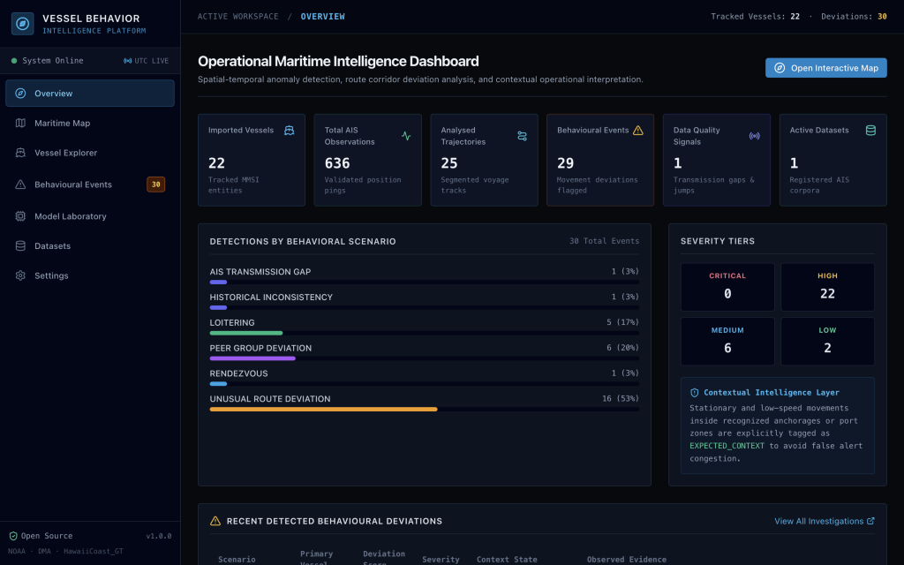
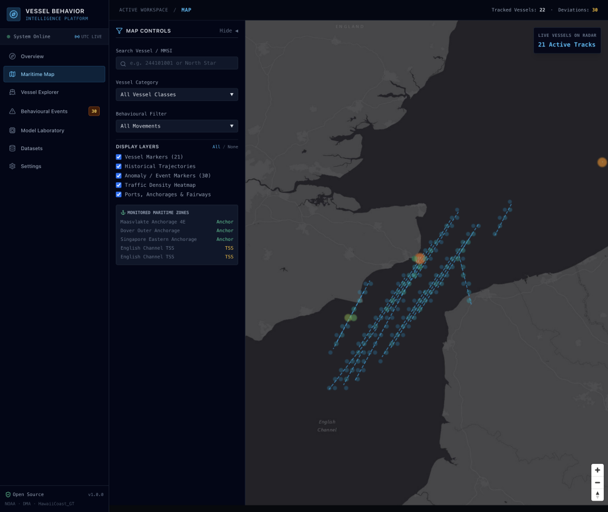
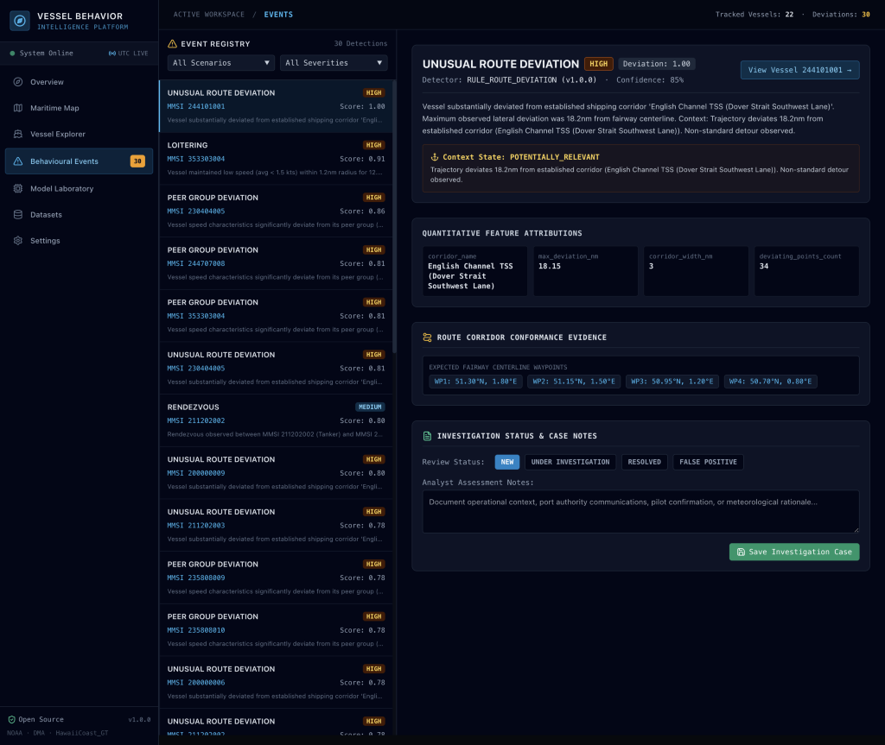
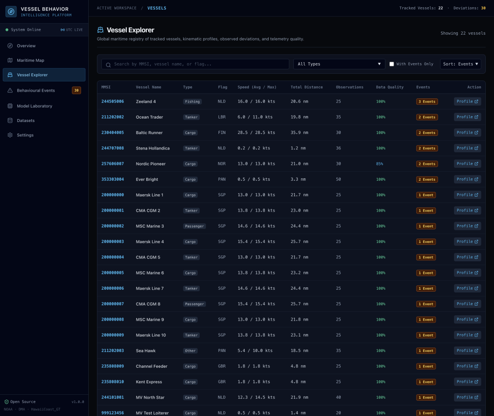
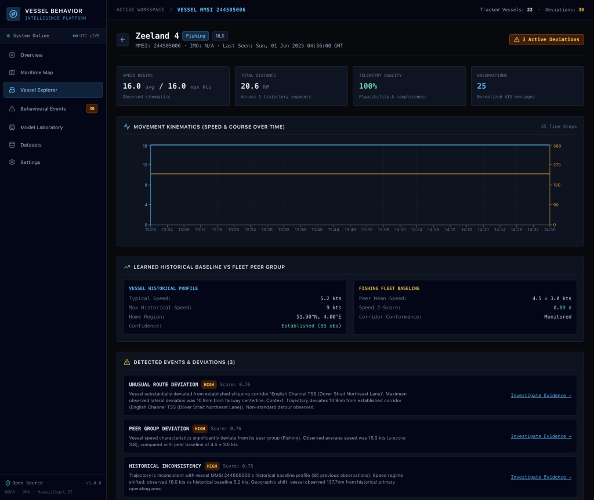
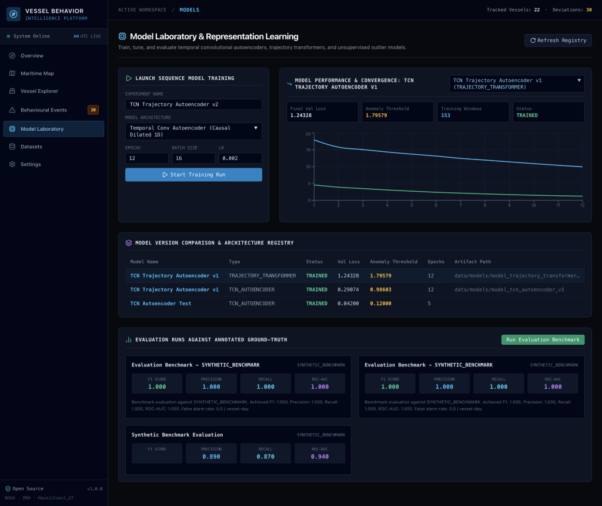
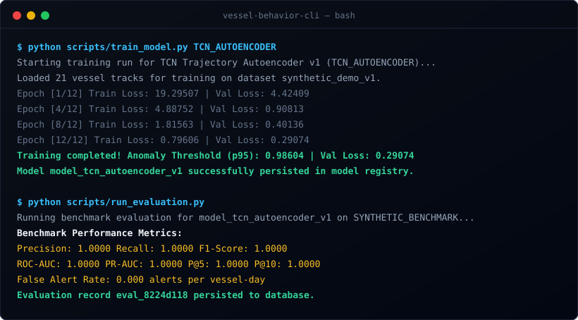
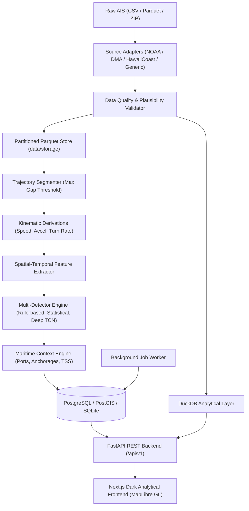

# Vessel Behavior Analysis Platform

[](./LICENSE)
[](https://www.python.org/)
[](https://fastapi.tiangolo.com/)
[](https://pytorch.org/)
[](https://nextjs.org/)
[](https://duckdb.org/)
[](./tests)

A complete, production-quality open-source maritime vessel behaviour analysis platform.

The system learns what normal maritime movement looks like, identifies unusual vessel behaviour, and provides maritime operators and human analysts with quantitative, explainable evidence to investigate why a particular trajectory or vessel interaction is anomalous.

This is **not** a generic GPS tracking application or simple AIS map viewer. Its central focus is **behavioural intelligence**: understanding movement over time, learning normal patterns, identifying deviations, analysing pairwise interactions between vessels, and distinguishing meaningful anomalous behaviour from data-quality issues or routine maritime operations.

---

## Operational Overview


_Operational Maritime Intelligence Dashboard showing tracked vessel statistics, real-time behavioral scenario breakdown, severity distributions, and high-priority detected deviations._

---

## Key Capabilities

- **Unusual Route Deviation Analysis:** Detects vessels deviating from established Traffic Separation Schemes (TSS) or historical shipping corridors.
- **Rendezvous & Proximity Detection:** Identifies close encounters, computes inter-vessel distance timelines, and distinguishes open-water rendezvous from routine tug escorts.
- **Loitering & Dwell Intelligence:** Contextualizes low-speed dwell behavior, recognizing designated anchorages and port congestion to prevent false alarms.
- **Peer-Group Kinematic Deviation:** Benchmarks vessel speed and turn rates against class distributions (Cargo, Tanker, Fishing, Passenger, Tug).
- **Historical Profile Inconsistency:** Learns vessel-specific operating areas and speeds when historical data is sufficient.
- **AIS Observability Gap Tracking:** Identifies transmission loss as telemetry data quality signals rather than fabricating unobserved paths.
- **Explainable Anomaly Scoring:** Breaks down every detection into quantitative feature attributions and contextual explanations.
- **Deep Sequence Modeling:** Features a 1D Causal Dilated Temporal Convolutional Autoencoder (TCN Autoencoder) and comparative Trajectory Transformer in PyTorch.
- **Columnar Analytical Storage:** Employs partitioned Parquet and DuckDB for sub-millisecond trajectory lookups and spatial density heatmaps.
- **Interactive Dark Maritime Interface:** Modern Next.js and MapLibre GL JS dark analytical interface with responsive inspection drawers.

---

## Visual Showcase & Interface Walkthrough

### 1. Interactive Maritime Situational Map


_MapLibre GL JS dark situational map displaying real-time vessel vectors, historical trajectories, designated traffic lanes (TSS corridors), anchorages, and spatial density heatmaps in the Dover Strait._

### 2. Explainable Behavioral Event Investigation


_Detailed event investigation view breaking down an anomaly into quantitative feature attributions, corridor deviation measurements, contextual interpretation, and analyst case management tools._

### 3. Vessel Registry & Kinematic Profiling


_Searchable global vessel directory showing kinematic statistics (average/maximum speed), voyage distances, AIS observation volumes, telemetry quality ratings, and flagged deviation counts._

### 4. Vessel Kinematic Timeline & Baseline Modeling


_Deep-dive vessel profile featuring dual-axis speed and course time series, comparisons against learned historical baselines and fleet peer groups, and a chronological event log._

### 5. Representation Learning & Model Laboratory


_Interactive model laboratory for training and comparing deep sequence models (TCN Autoencoder, Trajectory Transformer), tracking training loss convergence, and running benchmark evaluations._

### 6. Command-Line Training & Evaluation Pipeline


_Command-line workflow demonstrating sequence model training with loss convergence tracking and automated benchmark evaluation against ground-truth annotations._

---

## Supported Behavioural Scenarios

| Scenario                         | Detection Strategy                                                                     | Contextual Interpretation                                                     |
| :------------------------------- | :------------------------------------------------------------------------------------- | :---------------------------------------------------------------------------- |
| **A. Unusual Route Deviation**   | Lateral deviation from shipping corridor centerline $>3.5\text{ NM}$                   | Checks alignment with recognized separation schemes and coastal fairways      |
| **B. Unusual Rendezvous**        | Inter-vessel distance $\le 600\text{m}$, duration $\ge 15\text{m}$, low relative speed | Distinguishes open sea rendezvous from port tug assists & pilot transfers     |
| **C. Loitering / Unusual Dwell** | SOG $\le 1.5\text{ kts}$, radius $\le 1.2\text{ NM}$, duration $\ge 2.0\text{ hours}$  | Normalizes anchorages (Maasvlakte, Dover, Singapore) & active fishing grounds |
| **D. Peer-Group Deviation**      | Statistical $z$-score on speed distribution $>2.5\sigma$                               | Benchmarks against vessel class operating baselines                           |
| **E. Historical Inconsistency**  | Deviation from vessel's established baseline ($\ge 30$ observations)                   | Distinguishes fleet anomalies from established vessel-specific profiles       |
| **F. AIS Transmission Gaps**     | Transmission silence $\ge 2.0\text{ hours}$                                            | Exposes RF coverage and receiver pass limits; never silently interpolates     |

---

## Architecture Overview



---

## Technology Stack

- **Backend & Processing:** Python 3.12+, FastAPI, Pydantic, SQLAlchemy, Alembic, Polars, DuckDB, PyArrow / Parquet, Shapely, PyProj, Scikit-learn, PyTorch, NumPy, SciPy.
- **Frontend:** Next.js 15, React 19, TypeScript, Tailwind CSS, MapLibre GL JS, TanStack Query, Zustand, Recharts, Lucide Icons.
- **Storage & Infrastructure:** Dual-mode database (zero-config SQLite for standalone local run; PostgreSQL + PostGIS via Docker Compose), local filesystem Parquet partitioning, in-process background worker queue.

---

## Getting Started

### 1. Prerequisites

- Python 3.12+ (Python 3.12 or 3.13)
- Node.js v20+ or v22+
- `pnpm` v9+ or v10+
- `uv` (recommended)

### 2. Local Installation

```bash
# Clone the repository
git clone https://github.com/ranajahanzaib/maritime-anomaly-detection.git
cd maritime-anomaly-detection

# Create virtual environment and install backend dependencies
uv venv
source .venv/bin/activate
uv pip install -e ".[dev]"

# Install frontend dependencies
cd frontend
pnpm install
cd ..
```

### 3. Generate Demonstration Dataset

The repository includes a deterministic synthetic AIS data generator that builds realistic trajectories and all demonstration scenarios in the English Channel and North Sea:

```bash
PYTHONPATH=. .venv/bin/python scripts/generate_demo_data.py
```

### 4. Train the Temporal Deep Learning Models

Train the PyTorch Temporal Convolutional Autoencoder or Trajectory Transformer on the extracted trajectory windows:

```bash
# Train Temporal Convolutional Autoencoder (TCN)
PYTHONPATH=. .venv/bin/python scripts/train_model.py TCN_AUTOENCODER

# Train Trajectory Transformer (Self-Attention)
PYTHONPATH=. .venv/bin/python scripts/train_model.py TRAJECTORY_TRANSFORMER
```

### 5. Benchmark Model Evaluation

Evaluate detector performance against annotated ground-truth:

```bash
PYTHONPATH=. .venv/bin/python scripts/run_evaluation.py
```

Outputs:

- **Precision, Recall, F1 Score**
- **PR-AUC & ROC-AUC**
- **Precision@5 and Precision@10**
- **False Alerts per Vessel-Day**

### 6. Run the Automated Test Suite

```bash
PYTHONPATH=. .venv/bin/pytest tests/ -v
```

### 7. Start the Application

In **Terminal 1** (Backend API on `http://localhost:8000`):

```bash
PYTHONPATH=. .venv/bin/uvicorn backend.app.main:app --host 0.0.0.0 --port 8000 --reload
```

In **Terminal 2** (Frontend on `http://localhost:3000` or custom port):

```bash
cd frontend
pnpm run dev
```

Open [http://localhost:3000](http://localhost:3000) in your browser.

---

## Running with Docker Compose

To run the complete platform with PostgreSQL and PostGIS in Docker:

```bash
docker compose up --build
```

- Web Interface: [http://localhost:3000](http://localhost:3000)
- Interactive API Documentation: [http://localhost:8000/api/v1/docs](http://localhost:8000/api/v1/docs)

---

## External Dataset Ingestion

To ingest external AIS datasets:

```bash
# Import NOAA MarineCadastre AIS CSV or Parquet
python scripts/import_dataset.py /path/to/noaa_ais.parquet --source NOAA

# Import HawaiiCoast_GT Benchmark
python scripts/import_dataset.py /path/to/hawaiicoast.csv --source HAWAII_COAST

# Import Danish Maritime Authority AIS Trajectories
python scripts/import_dataset.py /path/to/danish_trajectories.csv --source DANISH_AIS
```

---

## REST API Reference Summary

| Endpoint                              | Method  | Description                                                        |
| :------------------------------------ | :------ | :----------------------------------------------------------------- |
| `/api/v1/overview/stats`              | `GET`   | High-level platform metrics and category distribution.             |
| `/api/v1/vessels`                     | `GET`   | Searchable vessel directory with filters and kinematic statistics. |
| `/api/v1/vessels/{mmsi}`              | `GET`   | Vessel profile, learned baseline, and trajectory segments.         |
| `/api/v1/vessels/{mmsi}/trajectories` | `GET`   | Simplified GeoJSON trajectory segments.                            |
| `/api/v1/map/density`                 | `GET`   | Aggregated spatial density grid cells for traffic heatmap.         |
| `/api/v1/map/vessels`                 | `GET`   | Latest vessel positions and headings as GeoJSON.                   |
| `/api/v1/map/zones`                   | `GET`   | Reference ports, anchorages, and shipping corridors.               |
| `/api/v1/events`                      | `GET`   | Filterable behavioral events with deviation scores and severities. |
| `/api/v1/events/{id}`                 | `GET`   | Detailed event evidence, pairwise timelines, and attributions.     |
| `/api/v1/events/{id}`                 | `PATCH` | Update investigation review status and analyst notes.              |
| `/api/v1/models`                      | `GET`   | List registered sequence models and validation metrics.            |
| `/api/v1/models/train`                | `POST`  | Launch asynchronous model training run.                            |
| `/api/v1/evaluation/run`              | `POST`  | Run benchmark evaluation against annotated ground-truth.           |
| `/api/v1/export/events`               | `GET`   | Export events in JSON, CSV, or GeoJSON formats.                    |

Interactive OpenAPI Swagger docs are available at [http://localhost:8000/api/v1/docs](http://localhost:8000/api/v1/docs).

---

## Data Provenance & Citations

1. **NOAA MarineCadastre AIS:** US Bureau of Ocean Energy Management (BOEM) and National Oceanic and Atmospheric Administration (NOAA). Public domain.
2. **HawaiiCoast_GT Ground Truth Benchmark:** Zenodo Record 8253611. Licensed under CC-BY 4.0.
3. **Danish AIS Trajectory Datasets:** Danish Maritime Authority (DMA) open data.

---

## Scientific Limitations & Disclaimers

1. **Anomalies are not accusations:** An unusual speed, route deviation, or rendezvous does not imply illegal activity. Normal maritime operations (weather avoidance, port congestion waiting, pilotage, tug operations, fishing) frequently produce statistical outliers.
2. **Observability vs Intent:** AIS transmission gaps represent radio line-of-sight and satellite reception limits, not proof of intentional transponder manipulation.
3. **Synthetic Demonstration Data:** Synthetic trajectories are deterministic simulations designed for reproducible local testing. They are explicitly tagged with `is_synthetic=True` and are never conflated with real-world maritime incidents.

---

## License & Custom Work

[](mailto:work@withrana.com) [](https://www.linkedin.com/in/workwithrana)
[](https://www.upwork.com/freelancers/~01bbcf6edb91a8df5f)
[](https://contra.com/ranajahanzaib/)

**License:** MIT, see [LICENSE](LICENSE). Free for personal and commercial use.

**Author:** Rana Jahanzaib

**Need this built for your stack?** Email me what you're working on: work@withrana.com
