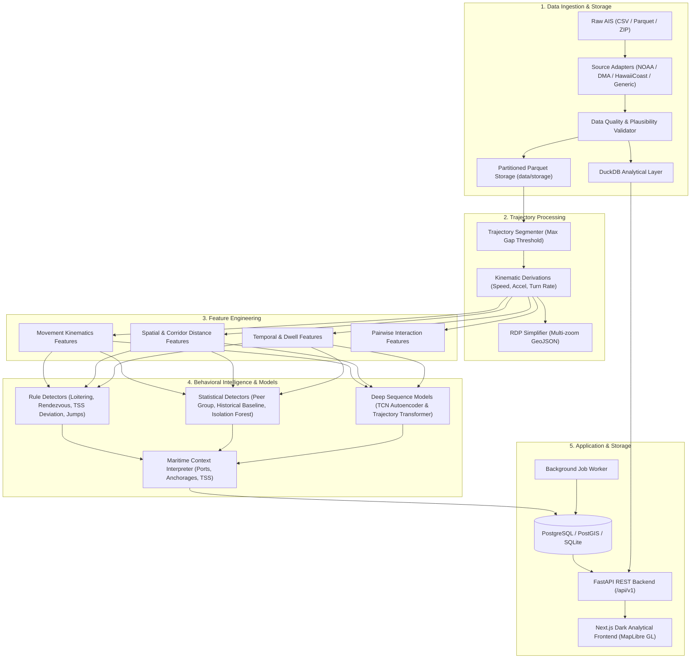
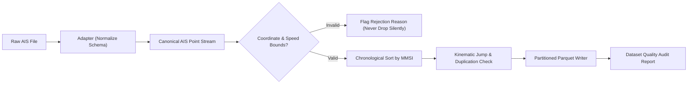
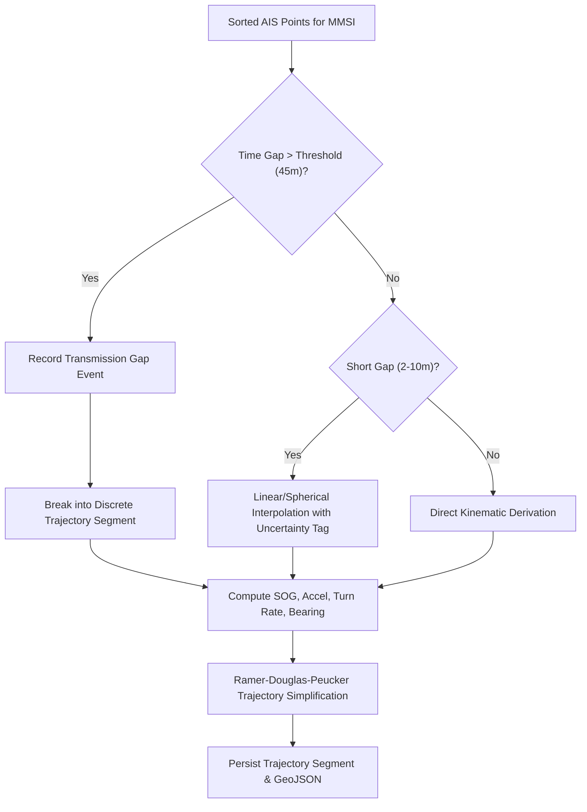
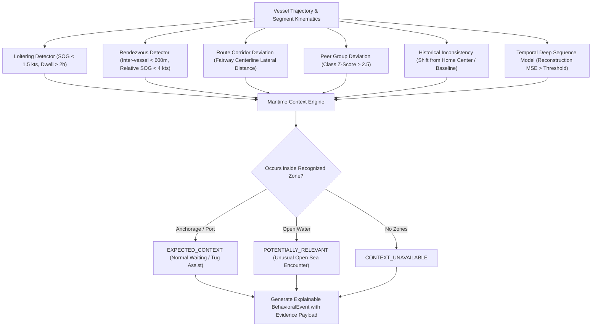
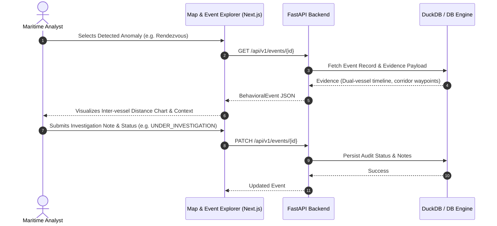
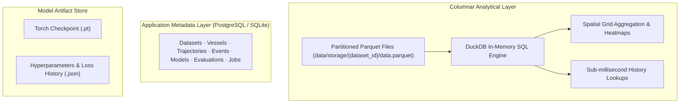

# System Architecture

The **Vessel Behavior Analysis Platform** is an open-source maritime movement intelligence system. Rather than acting as a static AIS viewer, it learns normal maritime movement patterns, detects multidimensional behavioral deviations, and provides human analysts with explainable evidence.

---

## 2. Ingestion Pipeline

---

## 3. Trajectory Processing Pipeline

---

## 4. Behavioural Detection Workflow

---

## 5. Model Training & Inference Workflow

```mermaid
flowchart LR
    Parquet["Parquet Trajectory Store"] --> Windows["Sliding Window Slicer (L=16/32 steps)"]
    Windows --> Center["Relative Center Normalization & Kinematics Scaling"]
    Center --> Split["Vessel-Grouped Train / Validation Split"]
    Split --> TCN["Temporal Conv Autoencoder / Transformer"]
    TCN --> Train["Epoch Loop with Adam & MSE Loss"]
    Train --> EvalThresh["Empirical Anomaly Threshold (p95 Validation Error)"]
    EvalThresh --> Registry["Model Store Checkpoint (.pt + metadata.json)"]
    Registry --> Inference["Inference Sequence Scorer"]
```

---

## 6. Event Investigation Flow

---

## 7. Data Storage Architecture

